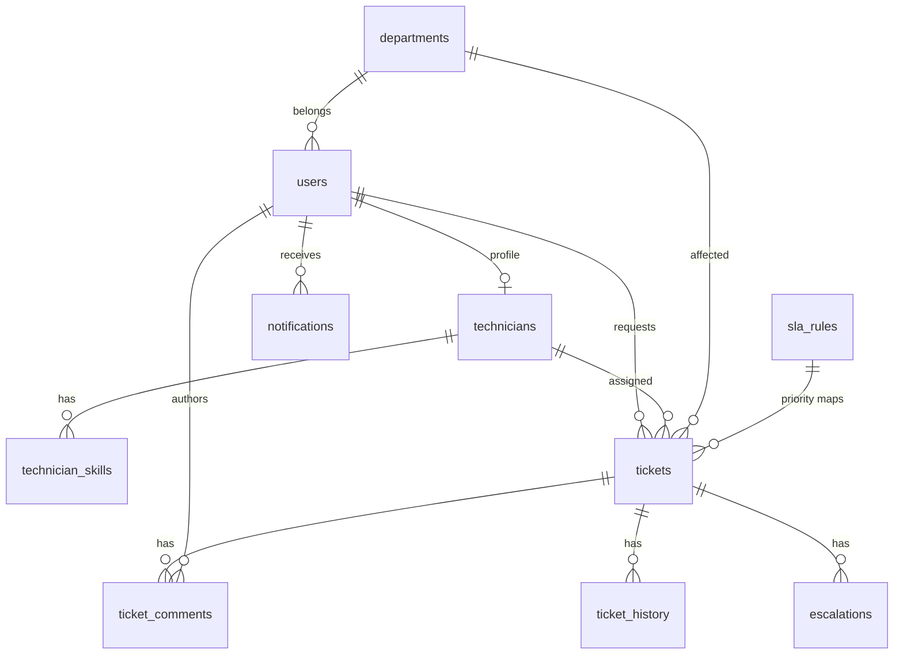

# Architecture — Enterprise IT Service Management System

## 1. Purpose

This document describes the proposed architecture for a **modular monolithic** IT Service Management (ITSM) application. It is the source of truth for structure, request flow, data relationships, and deployment shape.

The system manages IT support tickets, technician assignment, SLA monitoring, recurring-incident analysis, and technician performance analytics. It is designed for an IBM Delivery Consultant internship demonstration: production-style, explainable, and not over-engineered.

**Decision:** one Flask application, one PostgreSQL database, Docker Compose for local/cloud-portable runs. No microservices, message brokers, or distributed tracing in the first delivery.

---

## 2. Architectural Style

**Modular monolith** with five logical layers:

| Layer | Responsibility | Typical location |
| ----- | -------------- | ---------------- |
| Presentation | Server-rendered HTML, forms, Chart.js dashboards | `app/web/`, `templates/`, `static/` |
| API | JSON REST endpoints, HTTP status codes, auth headers | `app/api/` |
| Business logic | Priority, assignment, SLA, analytics, incident analysis | `app/services/` |
| Database | SQLAlchemy models, transactions, migrations | `app/models/`, `migrations/` |
| Authentication and authorization | Login, hashing, sessions/JWT, RBAC | `app/auth/`, decorators, Flask extensions |

Flask **Blueprints** isolate feature areas. Application factory (`create_app`) wires configuration, extensions, blueprints, and CLI. Business rules never live in `app.py` or in route handlers beyond thin request/response mapping.

```
Browser / API client
        │
        ▼
┌───────────────────┐
│  Presentation /   │
│  REST API layer   │  Blueprints + CSRF (forms) / JWT (API)
└─────────┬─────────┘
          ▼
┌───────────────────┐
│  Auth & RBAC      │  Role checks before service calls
└─────────┬─────────┘
          ▼
┌───────────────────┐
│  Business services│  Priority, assignment, SLA, analytics
└─────────┬─────────┘
          ▼
┌───────────────────┐
│  SQLAlchemy ORM   │  Models, transactions, indexes
└─────────┬─────────┘
          ▼
     PostgreSQL
```

---

## 3. Folder Structure (proposed)

```
Enterprise IT Service Management System/
├── README.md
├── ARCHITECTURE.md
├── TASKS.md
├── HANDOFF.md
├── .env.example
├── .gitignore
├── Dockerfile
├── docker-compose.yml
├── .dockerignore
├── requirements.txt
├── requirements-dev.txt
├── pytest.ini
├── wsgi.py                      # Gunicorn entry: wsgi:app
├── migrations/                  # Flask-Migrate / Alembic
├── docs/
│   └── API.md                   # REST endpoint catalog
├── tests/
│   ├── conftest.py
│   ├── test_auth.py
│   ├── test_tickets.py
│   ├── test_priority.py
│   ├── test_assignment.py
│   ├── test_sla.py
│   ├── test_analytics.py
│   └── test_security.py
├── app/
│   ├── __init__.py              # create_app factory
│   ├── config.py                # env-based config classes
│   ├── extensions.py            # db, migrate, login, jwt, csrf
│   ├── constants.py             # roles, statuses, categories, priorities
│   ├── models/
│   │   ├── __init__.py
│   │   ├── user.py
│   │   ├── department.py
│   │   ├── technician.py
│   │   ├── ticket.py
│   │   ├── sla.py
│   │   ├── escalation.py
│   │   └── notification.py
│   ├── services/
│   │   ├── __init__.py
│   │   ├── priority_engine.py   # rule-based (not ML)
│   │   ├── assignment_engine.py
│   │   ├── sla_engine.py
│   │   ├── incident_analysis.py
│   │   ├── analytics.py
│   │   └── notifications.py
│   ├── auth/
│   │   ├── __init__.py
│   │   └── decorators.py
│   ├── api/                     # JSON REST
│   │   ├── __init__.py
│   │   ├── auth.py
│   │   ├── tickets.py
│   │   ├── technicians.py
│   │   ├── sla.py
│   │   ├── analytics.py
│   │   ├── notifications.py
│   │   └── users.py
│   ├── web/                     # HTML views
│   │   ├── __init__.py
│   │   ├── auth.py
│   │   ├── dashboards.py
│   │   ├── tickets.py
│   │   ├── technicians.py
│   │   ├── sla.py
│   │   ├── analytics.py
│   │   ├── notifications.py
│   │   └── profile.py
│   ├── scheduler/
│   │   ├── __init__.py
│   │   └── jobs.py              # SLA scan with DB advisory lock
│   ├── templates/
│   └── static/
│       ├── css/
│       └── js/
└── scripts/
    └── seed_dev.py              # optional local seed; never used in prod logic
```

---

## 4. Component Descriptions

### 4.1 Application factory and configuration

- `config.py` loads `SECRET_KEY`, database URL, JWT settings, and SLA scheduler interval from environment variables.
- Classes: `DevelopmentConfig`, `TestingConfig` (SQLite in-memory or dedicated test DB), `ProductionConfig` (fail fast if secrets missing).
- No passwords or keys in source control.

### 4.2 Authentication and authorization

**Web UI:** Flask-Login sessions, HttpOnly cookies, `SESSION_COOKIE_SECURE` in production, Flask-WTF CSRF on forms.

**REST API:** Flask-JWT-Extended access tokens (short-lived). Optional refresh tokens can be added later; not required for the first delivery.

**Passwords:** Werkzeug `generate_password_hash` / `check_password_hash` (pbkdf2:sha256 or scrypt). Never log credentials.

**Roles:** `admin`, `technician`, `employee`. Decorators enforce role and object-level rules (employees see only their tickets; technicians see assigned tickets plus queue policies defined in services).

**User vs technician:** Every person is a `User`. Technicians have a related `Technician` profile (expertise, availability, workload cap). Admins may also have a technician profile if needed; default is separate.

### 4.3 Ticket management

CRUD through services, not raw SQL. Ticket numbers are generated sequentially (e.g. `INC-2026-000001`) inside a transaction. Status transitions are validated:

```
Open → Assigned → In Progress → On Hold → In Progress
                 → Resolved → Closed
Employee may reopen Closed/Resolved → Open (policy: only requester, within configurable window or always if not Closed-final; implement: reopen from Resolved or Closed → Open, record history)
```

Comments and history are append-only.

### 4.4 Priority recommendation engine (rule-based)

**Not AI/ML.** Deterministic scoring from:

| Input | Weight (initial) |
| ----- | ---------------- |
| Business impact (low / medium / high / critical) | 0–40 |
| Urgency (low / medium / high / critical) | 0–30 |
| Affected user count (1 / 2–10 / 11–50 / 50+) | 0–20 |
| Category modifiers (Network, Security, Database boost; Software install penalty) | −10 to +10 |

Score bands map to recommended priority: Critical / High / Medium / Low.

Stored separately:

- `recommended_priority` — engine output, immutable after create except if inputs change and engine is re-run.
- `final_priority` — used for SLA; admin may override; override reason stored in ticket history.

Exact numeric table will live in `app/services/priority_engine.py` and be documented in `docs/PRIORITY_RULES.md` when implemented.

### 4.5 Technician assignment engine

Score eligible technicians:

1. `availability_status == available` (exclude unavailable).
2. Category matches `technician_skills`.
3. Lower active workload (count of tickets in Open/Assigned/In Progress/On Hold) preferred.
4. Do not exceed `max_concurrent_tickets`.

If no eligible technician, ticket stays `Open` and admin is notified. Admin may override assignment.

### 4.6 SLA monitoring and escalation

`sla_rules` table: one row per priority with configurable `resolution_hours` (defaults: Critical 2, High 6, Medium 24, Low 48). Optional `warning_percent` (e.g. 80% of window).

Deadline = `created_at + resolution_hours` (or `assigned_at` if product later switches; **decision: clock starts at ticket creation** unless admin configures otherwise — store `clock_start` on the rule as `created` for v1).

Background job (APScheduler in-process, or a `flask sla-scan` CLI run by the container command loop):

- Uses PostgreSQL advisory lock so only one worker runs the scan.
- Marks approaching / breached.
- Creates `escalations` rows (idempotent: one active escalation per ticket per breach level).
- Creates in-app notifications.

Gunicorn with multiple workers must not run duplicate schedulers: **only the web process in Docker Compose runs the scheduler if `ENABLE_SCHEDULER=true` on a single replica; extra replicas disable it.** Document this for cloud.

### 4.7 Recurring incident analysis

Explainable heuristics (not clustering ML):

- Group by category + department over a time window.
- Tokenize titles/descriptions (stop-word filtered); find repeated keyword pairs.
- Surface “possible common cause” as **hypotheses**, never as confirmed root cause.

### 4.8 Analytics and dashboards

Aggregations in `analytics.py` using SQLAlchemy queries. Chart.js on admin/technician dashboards consumes either server-injected JSON or `/api/analytics/*`.

### 4.9 Notifications

In-app rows in `notifications`. Email is optional and behind `MAIL_ENABLED`; stub interface only until explicitly implemented.

---

## 5. Request Flow

### Browser (create ticket)

1. Employee authenticates; session cookie set.
2. GET `/tickets/new` — CSRF token in form.
3. POST `/tickets` — web blueprint validates input.
4. Service: priority engine → persist ticket → notify admins.
5. Redirect to ticket detail with flash message.

### API (assign technician)

1. Client sends `Authorization: Bearer <jwt>`.
2. `POST /api/technicians/assign` with ticket id and optional override technician id.
3. RBAC: admin only (or auto-assign job).
4. Assignment engine recommends; admin override recorded in history.
5. Status → Assigned; notify technician and requester.
6. JSON 200 with ticket payload.

### SLA scan

1. Scheduler acquires advisory lock.
2. Load open tickets with `sla_deadline`.
3. Update breach flags; insert escalations; notify.
4. Release lock.

---

## 6. Database Design

PostgreSQL. SQLAlchemy models + Alembic migrations. Application-generated UUIDs or integer PKs: **decision: integer PKs** for simplicity and readable FKs; `ticket_number` is the human identifier.

### Entity-relationship overview



### Tables

**departments**

| Column | Type | Notes |
| ------ | ---- | ----- |
| id | PK int | |
| name | varchar(120) unique not null | |
| description | text | |
| created_at | timestamptz | |

**users**

| Column | Type | Notes |
| ------ | ---- | ----- |
| id | PK int | |
| email | varchar(255) unique not null | indexed |
| password_hash | varchar(255) not null | |
| first_name, last_name | varchar(80) not null | |
| role | varchar(20) not null | check: admin/technician/employee |
| department_id | FK departments nullable | |
| is_active | boolean default true | |
| created_at, updated_at | timestamptz | |

**technicians**

| Column | Type | Notes |
| ------ | ---- | ----- |
| id | PK int | |
| user_id | FK users unique not null | |
| availability_status | varchar(20) | available / busy / unavailable |
| max_concurrent_tickets | int default 10 | |
| created_at | timestamptz | |

**technician_skills**

| Column | Type | Notes |
| ------ | ---- | ----- |
| id | PK int | |
| technician_id | FK technicians | |
| category | varchar(40) | Network, Hardware, Software, Database, Security, Other |
| Unique (technician_id, category) | | |

**sla_rules**

| Column | Type | Notes |
| ------ | ---- | ----- |
| id | PK int | |
| priority | varchar(20) unique | Critical/High/Medium/Low |
| resolution_hours | numeric not null | |
| warning_percent | int default 80 | |
| clock_start | varchar(20) default 'created' | |
| updated_at | timestamptz | |
| updated_by_id | FK users nullable | |

**tickets**

| Column | Type | Notes |
| ------ | ---- | ----- |
| id | PK int | |
| ticket_number | varchar(32) unique not null | indexed |
| title | varchar(200) not null | |
| description | text not null | |
| category | varchar(40) not null | |
| business_impact | varchar(20) not null | |
| urgency | varchar(20) not null | |
| affected_users_count | int not null default 1 | check >= 1 |
| recommended_priority | varchar(20) not null | |
| final_priority | varchar(20) not null | indexed |
| status | varchar(20) not null | indexed |
| requester_id | FK users not null | |
| assigned_technician_id | FK technicians nullable | indexed |
| department_id | FK departments nullable | |
| sla_deadline | timestamptz nullable | indexed |
| sla_breached | boolean default false | |
| resolved_at, closed_at | timestamptz nullable | |
| created_at, updated_at | timestamptz | indexed created_at |

**ticket_comments** — id, ticket_id, user_id, body, created_at

**ticket_history** — id, ticket_id, user_id nullable, action, field_name, old_value, new_value, created_at

**escalations** — id, ticket_id, level (warning/breach), reason, created_at, acknowledged_at nullable, unique-ish via partial unique index on (ticket_id, level) where acknowledged_at is null **or** simple unique (ticket_id, level) for v1 to prevent duplicate rows

**notifications** — id, user_id, type, title, body, ticket_id nullable, is_read, created_at; index (user_id, is_read, created_at)

Indexes: tickets (status, final_priority, assigned_technician_id, sla_deadline, requester_id); users (email); notifications (user_id, is_read).

Transactions: ticket create + history + notification in one commit. Assignment similarly.

---

## 7. REST API Shape

All JSON. Errors: `{ "error": { "code": "...", "message": "..." } }` with 400/401/403/404/409/422/500.

Prefix `/api`.

| Method | Path | Auth |
| ------ | ---- | ---- |
| POST | /api/auth/register | public (role forced to employee unless admin creates users) |
| POST | /api/auth/login | public |
| POST | /api/auth/logout | session/JWT as applicable |
| GET | /api/tickets | role-scoped |
| POST | /api/tickets | employee, admin |
| GET | /api/tickets/<id> | owner, assignee, admin |
| PUT | /api/tickets/<id> | per field/role |
| DELETE | /api/tickets/<id> | admin (soft-delete or Closed-only; **decision: admin close/delete only if status allows; prefer status Closed over hard delete**) |
| GET | /api/technicians | admin |
| POST | /api/technicians/assign | admin |
| GET | /api/sla/rules | admin |
| PUT | /api/sla/rules/<id> | admin |
| GET | /api/sla/breaches | admin |
| GET | /api/analytics/dashboard | admin |
| GET | /api/analytics/technicians | admin, self for technician |
| GET | /api/notifications | authenticated |
| GET | /health | public, no secrets |

Full catalog in `docs/API.md` during implementation.

---

## 8. Frontend Approach

Server-rendered Jinja2 + Bootstrap 5 + small vanilla JS (filters, Chart.js). No SPA framework.

Layout: authenticated pages share sidebar + top bar (user, notification badge). Status badges color-coded. Tables: search, filter, pagination.

Pages map 1:1 to the product brief (login through profile).

Responsive: Bootstrap grid; sidebar collapses on mobile.

---

## 9. Background work and concurrency

- SLA job + advisory lock (`pg_try_advisory_lock`).
- `ENABLE_SCHEDULER` env flag.
- Tests freeze time (`freezegun` or datetime injection) for SLA.

---

## 10. Docker and cloud

**Compose services:** `web` (Flask/Gunicorn), `db` (postgres:16). Volume `pgdata`. Web waits for DB (`depends_on` + healthcheck + retry in entrypoint).

**Production:** Gunicorn `wsgi:app`, structured logging to stdout, `/health` for load balancers.

**Affordable deploy (no paid extras assumed):**

1. Single VM (AWS Lightsail / EC2 t3.micro / IBM Cloud VSI) + Docker Compose + managed or local Postgres.
2. Or IBM Cloud Code Engine / AWS App Runner / Render free-or-low-cost container, managed Postgres.

Cloud-specific code stays in `app/config.py` and docs, not in business services.

---

## 11. Security baseline

- ORM parameterized queries.
- CSRF on browser forms.
- RBAC + object-level checks.
- Secrets from environment.
- Security headers (Flask-Talisman optional; at minimum session cookie flags).
- Validation with WTForms / marshmallow or manual validators in one module.
- Rate limiting deferred unless time allows (Flask-Limiter).

---

## 12. Testing strategy

Pytest + Flask test client. TestingConfig uses SQLite or ephemeral Postgres. Fixtures: admin, technician, employee users. Cover authz denials, invalid ticket payloads, engine unit tests (pure functions), SLA deadline math, analytics aggregation.

---

## 13. Implementation phases

See `TASKS.md`. **No application code until the user approves this architecture.**

Phase order: docs (this phase) → Flask skeleton + models + migrations → auth → tickets + engines → SLA scheduler → analytics/UI → Docker → tests → production config → docs polish.
